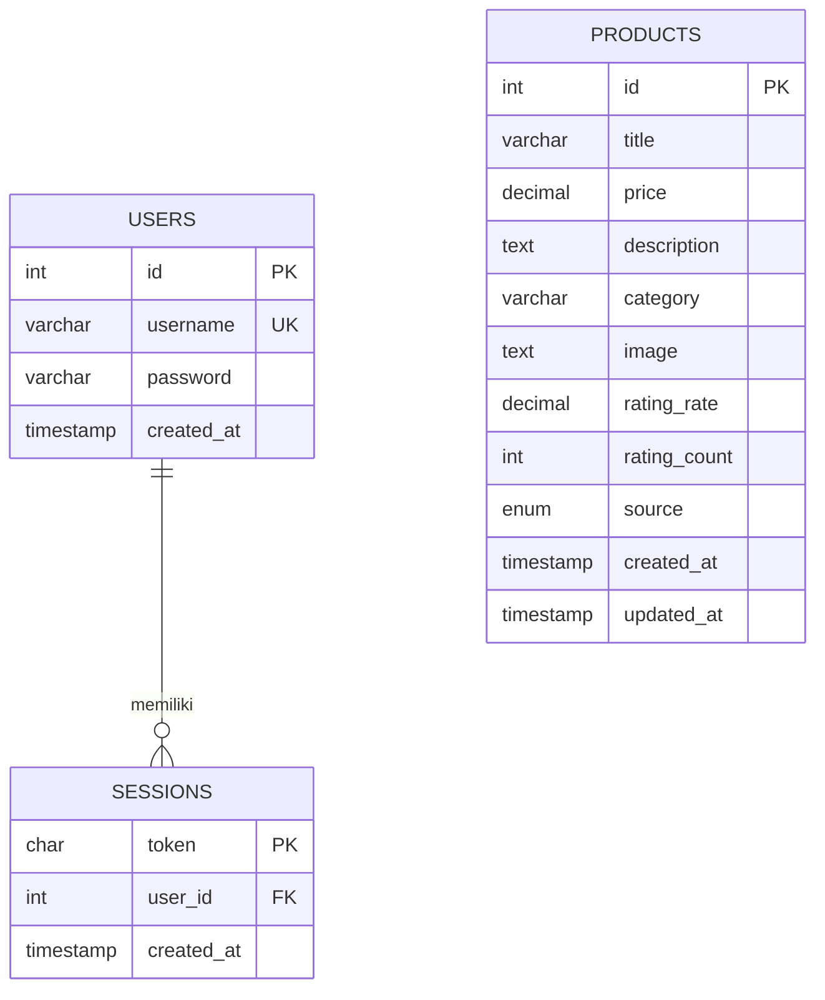

# Materi Database: Raw SQL, Indexing, dan ERD

Catatan ini sengaja disimpan di `docs/` (bukan komentar kode, dan bukan `README.md` yang di-gitignore).

## ERD



### Penjelasan relasi

- `users` → `sessions`: **one-to-many**. Satu user bisa punya banyak token login.
- `sessions.user_id` adalah **foreign key** ke `users.id` dengan `ON DELETE CASCADE`.
- `products` tidak punya relasi ke user. Kategori juga bukan tabel terpisah; daftar kategori diambil dari `SELECT DISTINCT category FROM products`.
- `users.username` bersifat **UNIQUE**, jadi otomatis ter-index.

## Indexing (Raw SQL)

Index adalah struktur data di database (B-Tree) yang mempercepat pencarian. Backend tidak perlu kode khusus: MySQL otomatis memakai index saat query mengandung kolom yang ter-index.

Index yang dibuat di `fakestore.sql`:

```sql
CREATE INDEX idx_users_created_at ON users(created_at);
CREATE INDEX idx_products_category ON products(category);
CREATE INDEX idx_products_price ON products(price);
CREATE INDEX idx_products_created_at ON products(created_at);
CREATE INDEX idx_products_category_price ON products(category, price);
```

Kegunaannya:

| Index | Dipakai untuk |
| ----- | ------------- |
| `username` (UNIQUE) | `WHERE username = ?` saat login |
| `idx_products_category` | filter kategori dan `DISTINCT category` |
| `idx_products_price` | `ORDER BY price` / filter harga |
| `idx_products_category_price` | `WHERE category = ? ORDER BY price` |
| `idx_users_created_at` | `ORDER BY created_at` |

Composite index `idx_products_category_price` mengikuti aturan **leftmost prefix**: index dipakai untuk `category` saja, atau `category + price`, tetapi tidak untuk `price` saja.

Cek apakah index benar-benar dipakai:

```sql
SHOW INDEX FROM products;
EXPLAIN SELECT * FROM products WHERE category = 'buku';
EXPLAIN SELECT * FROM products WHERE category = 'buku' ORDER BY price;
```

Perhatikan kolom `key` pada hasil `EXPLAIN`. Jika terisi nama index, berarti index dipakai. Jika `NULL`, MySQL melakukan full table scan.

Trade-off: index mempercepat **READ**, tetapi menambah ruang penyimpanan dan sedikit memperlambat **INSERT/UPDATE/DELETE** karena index ikut diperbarui.

Menghapus index:

```sql
DROP INDEX idx_products_category ON products;
```

## Bulk Insert

Menambah banyak baris sekaligus dalam satu statement lebih efisien daripada satu `INSERT` per baris:

```sql
INSERT INTO products
  (title, price, description, category, image, rating_rate, rating_count, source)
VALUES
  ('Produk A', 10.00, 'Deskripsi A', 'umum', '/images/product-placeholder.svg', 4.5, 10, 'manual'),
  ('Produk B', 20.00, 'Deskripsi B', 'umum', '/images/product-placeholder.svg', 4.2, 12, 'manual');
```

Agar tidak menulis 40 baris `VALUES` secara manual, `fakestore.sql` memakai iterasi lewat stored procedure dengan `WHILE`:

```sql
DELIMITER //

DROP PROCEDURE IF EXISTS generate_products//
CREATE PROCEDURE generate_products(IN total INT)
BEGIN
  DECLARE i INT DEFAULT 1;
  WHILE i <= total DO
    INSERT INTO products
      (title, price, description, category, image, rating_rate, rating_count, source)
    VALUES (
      CONCAT('Produk ', i),
      ROUND(10 + (i * 1.5), 2),
      CONCAT('Deskripsi otomatis untuk produk nomor ', i),
      ELT(MOD(i, 5) + 1, 'elektronik', 'pakaian', 'buku', 'rumah', 'olahraga'),
      '/images/product-placeholder.svg',
      ROUND(3.5 + (i MOD 15) / 10, 2),
      i * 3,
      'manual'
    );
    SET i = i + 1;
  END WHILE;
END//

DELIMITER ;

CALL generate_products(40);
DROP PROCEDURE IF EXISTS generate_products;
```

`ELT(MOD(i, 5) + 1, ...)` membuat kategori berputar dari lima pilihan, jadi data tetap beragam tanpa ditulis satu per satu. Ubah angka pada `CALL generate_products(40)` untuk menambah atau mengurangi jumlah baris.

## CRUD versi SQL

```sql
-- CREATE
INSERT INTO users (username, password) VALUES ('budi', 'password123');
INSERT INTO products (title, price, category, source)
VALUES ('Contoh', 19.99, 'umum', 'manual');

-- READ
SELECT * FROM users;
SELECT * FROM products WHERE id = 1;
SELECT DISTINCT category FROM products ORDER BY category;

-- UPDATE
UPDATE products SET price = 24.99 WHERE id = 1;
UPDATE users SET password = 'passwordbaru' WHERE username = 'budi';

-- DELETE
DELETE FROM products WHERE id = 1;
DELETE FROM users WHERE username = 'budi';
```

Password polos yang dimasukkan langsung lewat SQL di-hash otomatis oleh trigger `before_users_insert_hash` memakai SHA2 + salt. Login di backend mendukung hash SHA2 maupun bcrypt.
